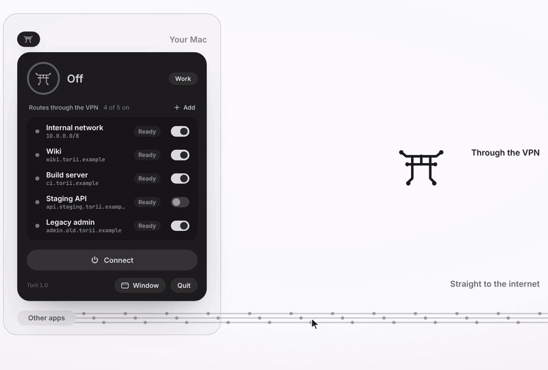
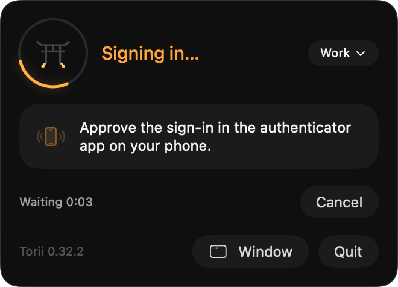
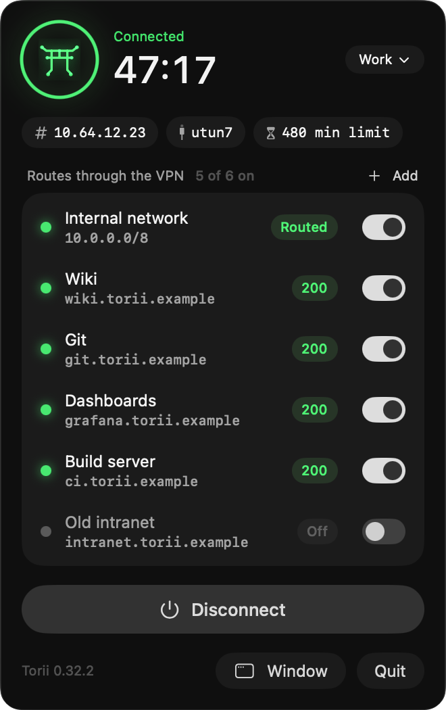
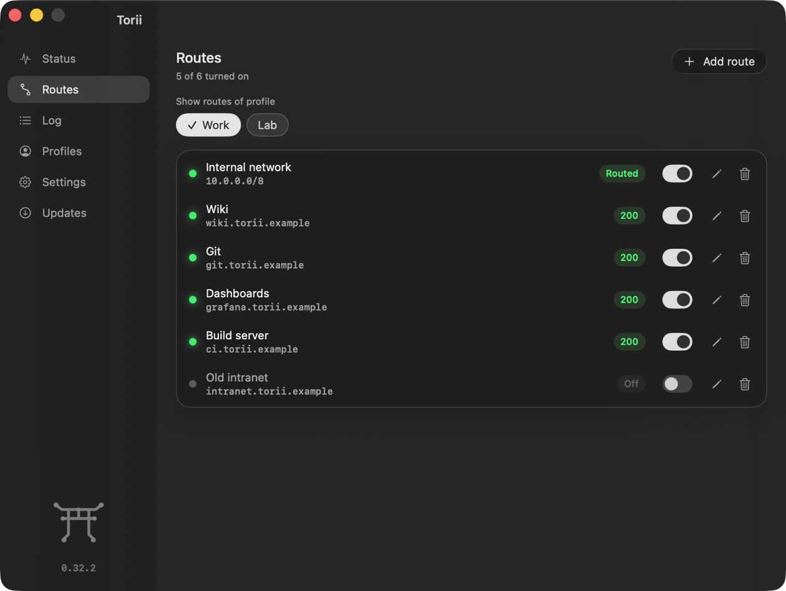
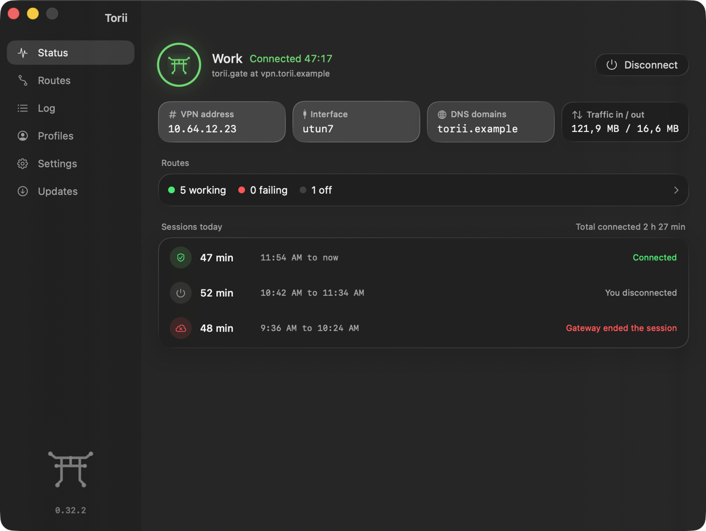
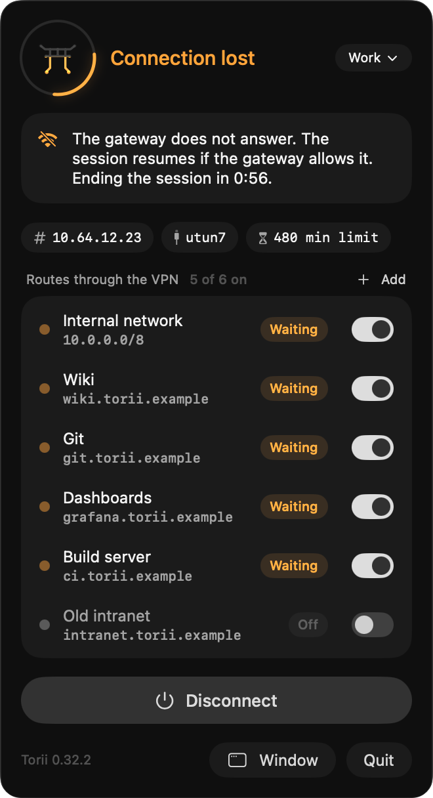
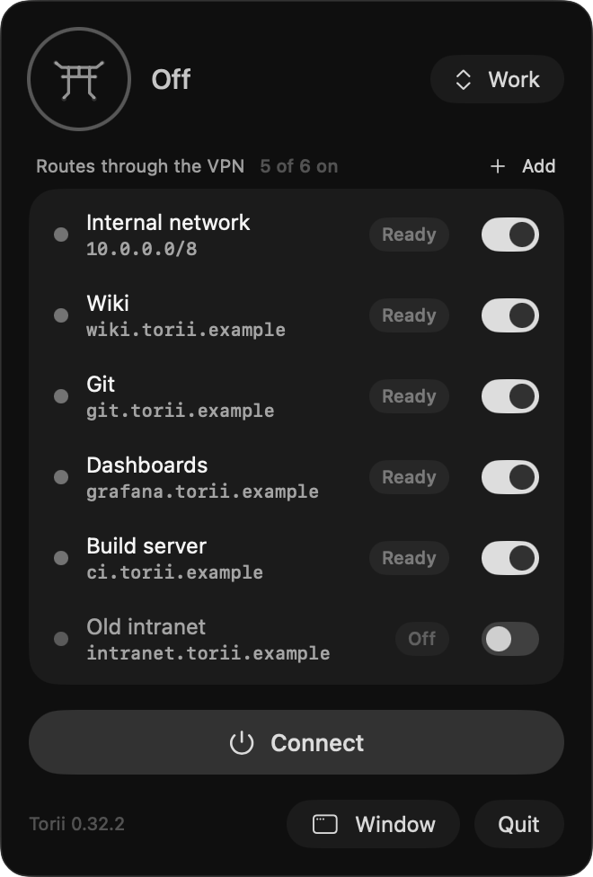
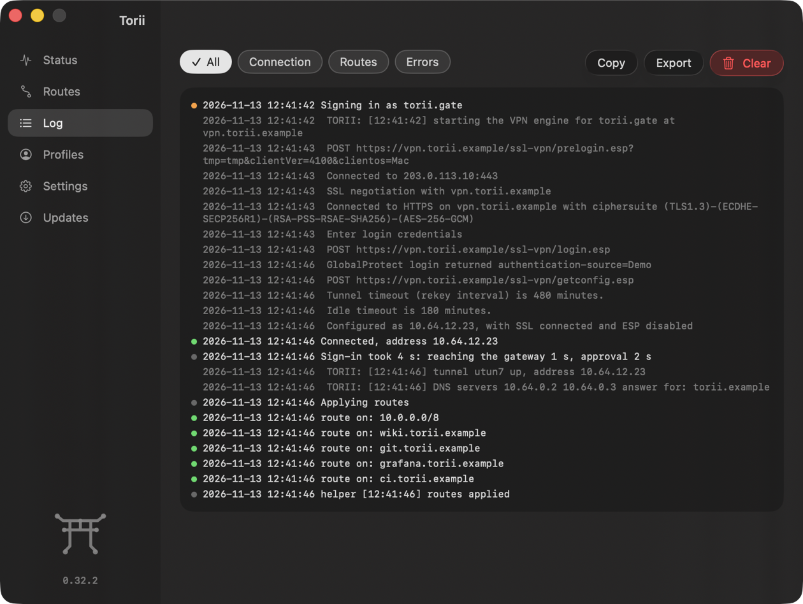
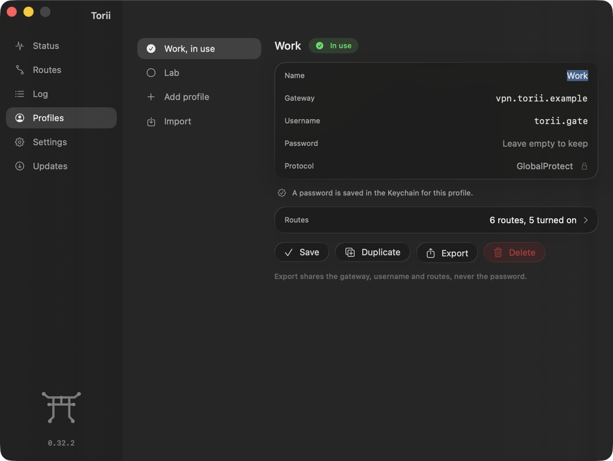

  

<h1 align="center">Torii</h1>

  A VPN client for your Mac's menu bar. 
  One click to connect, and only what you choose goes through the tunnel.

  <a href="https://github.com/osonicshimmertrap/torii-releases/releases/latest"><b>Download Torii</b></a>
   
  macOS 26 or later, Apple Silicon. For GlobalProtect gateways.

  

## Connect from the menu bar

Click the gate, press Connect, approve on your phone if your gateway asks
for it. The gate turns green and the timer starts. Your password stays in
the macOS Keychain.

  
  &nbsp;&nbsp;
  

## Only what you choose goes through the VPN

A route is a name plus a host, an address or a network. Add the ones you
need, switch them on and off while connected, and everything else keeps
using your normal connection: video calls, music, downloads.

  

Torii shows whether each route really works: amber while it is being
checked, green with the answer when the host responds through the tunnel,
red with the reason when it does not.

## You always know what is going on

How long you have been connected, which address you got, how today's
sessions ended and why.

  

When the network drops, Torii says so at once and does not pretend to be
connected. If the session survives, it carries on; if not, you are told
why and can connect again.

  
  &nbsp;&nbsp;
  

## A log you can read

Plain sentences first, the engine's own lines underneath for when you
need them. Filter it, copy it, export it. Passwords and session cookies
never reach it.

  

## Several gateways, several profiles

Each profile has its own gateway, username and routes. Duplicate one,
export it without its password to hand to a colleague, import theirs.

  

## It leaves your Mac alone

- **Your normal connection stays the default.** The VPN never becomes
  your Mac's main network, and its name servers answer only for the
  gateway's own domains.
- **A gateway cannot redirect the whole machine.** It may only route
  private networks and answer for its own names.
- **It cleans up after itself**, also after a crash, and can remove
  itself completely, helper and saved passwords included.
- **Nothing else to install.** The VPN engine, OpenConnect, is inside the
  app.

## It does not watch you

Torii talks to its author's server in exactly two cases:

- **Once per version:** that a copy was installed or updated, with the
  Torii version and the macOS version.
- **Once a week, and when you ask:** "which version is the latest?", a
  question that carries nothing.

No identifier, no account. Never your gateway, username, routes, host
names or log. It counts copies, not people, and it tells you all of this
before it sends anything. Both can be switched off.

## Updates on a click

When a newer version exists, Torii tells you. It installs it only when
you press **Install update**, and only after checking the package against
a key built into the app, so only packages made by Torii's author are
accepted.

## Install

Torii is not signed with an Apple Developer ID, so macOS asks for an
extra approval the first time.

1. [Download](https://github.com/osonicshimmertrap/torii-releases/releases/latest)
   the disk image, open it, and drag **Torii** to **Applications** in
   Finder. Do not run it from the disk image or the Downloads folder.
2. Open Torii. macOS blocks it. Open **System Settings -> Privacy &
   Security**, scroll to the message about Torii, and press **Open
   Anyway**.
3. Click the gate in the menu bar and fill in the profile: a name, the
   gateway's host name, your username and your password.
4. Press **Set up** and enter your Mac password. This installs Torii's
   helper and VPN engine and approves the gateway.
5. Press **Connect**.

After an update macOS may ask once whether Torii may use the saved
password (choose **Always Allow**), and Torii may ask for your Mac
password to update its helper.

## Good to know

- GlobalProtect only, with a username and password. Certificate and SAML
  sign-in are not supported.
- The gateway decides how long a session lasts. Torii shows the limit and
  tells you when a session ends; it does not sign in again by itself.
- IPv4 only.
- The screenshots show made-up names and addresses.

## Planned

- Fortinet gateways
- OpenVPN
- A "Shared" label for routes
- A one-press update

## Licence

Torii is released under the [Functional Source License, Version 1.1, MIT
Future License](LICENSE.md). It bundles OpenConnect, GnuTLS and other
libraries under the GNU Lesser General Public License and similar
licences, and the Sparkle updater under the MIT licence; their licence
texts are inside the app.

This repository holds the downloads and the list of versions that
installed copies read. It holds no source code.
